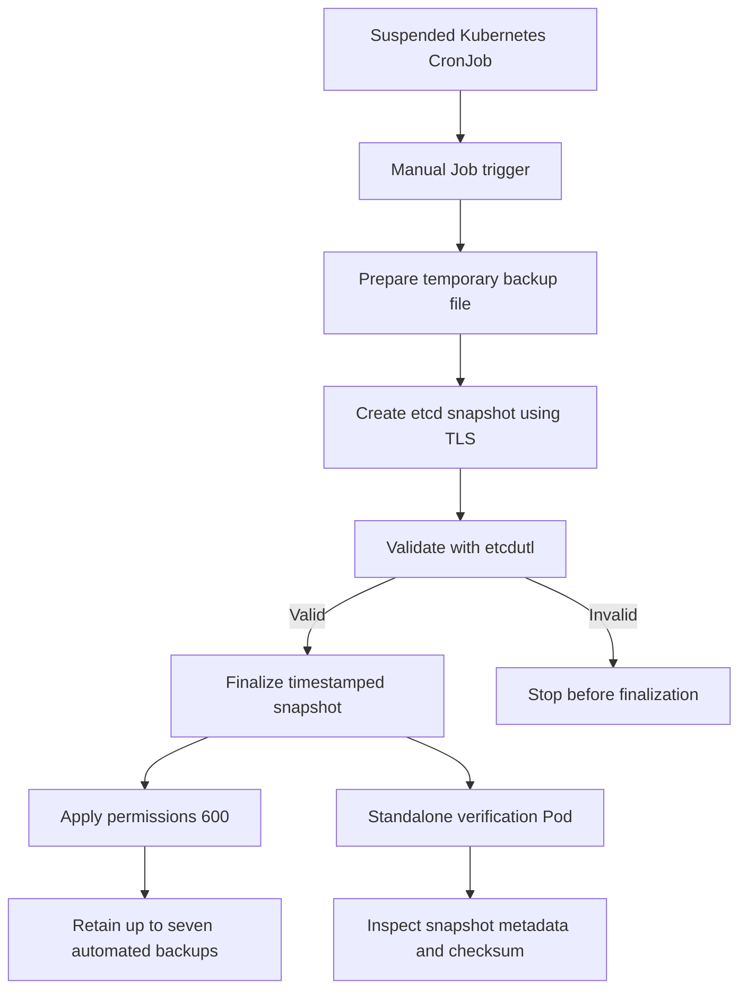

# Kubernetes etcd Backup and Disaster Recovery

A Kubernetes infrastructure project demonstrating automated etcd snapshot backups, snapshot validation, secure backup storage, retention management, and disaster recovery verification.

The project focuses on creating and validating etcd snapshots without modifying the live etcd data directory or performing a live-cluster restore.

## At a Glance

- **Platform:** Ubuntu 24.04, Kubernetes v1.37.0, etcd 3.7.0
- **Backup mechanism:** TLS-authenticated etcd snapshots
- **Validation:** `etcdutl snapshot status`
- **Retention:** Up to seven newest automated backups
- **Integrity:** SHA-256 checksum verification
- **Permissions:** Restrictive `600` permissions for finalized backups
- **Recovery testing:** Isolated etcd snapshot restore
- **Operational safety:** Scheduled CronJob remains suspended

## Table of Contents

- [Overview](#overview)
- [Architecture](#architecture)
- [Project Structure](#project-structure)
- [Environment](#environment)
- [Backup Workflow](#backup-workflow)
- [Validation Results](#validation-results)
- [Security and Retention](#security-and-retention)
- [Disaster Recovery Testing](#disaster-recovery-testing)
- [Cluster Health Checks](#cluster-health-checks)
- [Usage](#usage)
- [Screenshots](#screenshots)
- [Safety Considerations](#safety-considerations)
- [Future Improvements](#future-improvements)
- [Project Status](#project-status)

## Overview

etcd is the distributed key-value store used by Kubernetes to maintain cluster state, resource definitions, and configuration. Losing this data can prevent a Kubernetes control plane from recovering correctly.

This project implements a staged backup workflow that:

- Creates snapshots using authenticated TLS.
- Validates snapshots before finalization.
- Uses timestamped filenames for automated backups.
- Applies restrictive file permissions.
- Retains the seven newest automated snapshots.
- Verifies saved snapshots through a standalone script.
- Performs basic Kubernetes cluster health checks.
- Supports isolated disaster recovery testing.

Testing was performed on a running Kubernetes environment using a manually triggered Job created from the backup CronJob.

**Safety note:** The scheduled CronJob remains suspended. The backup workflow was tested manually rather than by enabling recurring scheduled execution.

## Architecture

The backup process separates snapshot creation, validation, and finalization so that an incomplete or invalid snapshot is not treated as a completed backup.



### Workflow stages

1. **Preparation:** Handles stale temporary snapshot files.
2. **Snapshot creation:** Connects to the local etcd endpoint using TLS credentials.
3. **Validation:** Reads snapshot metadata using `etcdutl snapshot status`.
4. **Finalization:** Renames the validated snapshot to a timestamped filename.
5. **Security:** Applies restrictive file permissions.
6. **Retention:** Keeps up to seven newest automated snapshots.
7. **Verification:** Uses a temporary Kubernetes Pod to inspect a saved snapshot with the backup directory mounted read-only.

## Project Structure

```text
kubernetes-etcd-backup-dr/
├── manifests/
│   └── etcd-backup-cronjob.yaml
├── scripts/
│   ├── check-cluster-health.sh
│   └── verify-snapshot.sh
├── docs/
│   └── SCREENSHOT-GUIDE.md
├── screenshots/
│   ├── 01-cronjob-safety.png
│   ├── 02-backup-job-success.png
│   ├── 03-snapshot-validation.png
│   ├── 04-backup-integrity.png
│   └── 05-standalone-verification.png
├── .gitignore
└── README.md
```

## Environment

| Component | Version or configuration |
|---|---|
| Operating system | Ubuntu 24.04 |
| Kubernetes | v1.37.0 |
| etcd | 3.7.0 |
| Backup execution | Kubernetes CronJob and manually triggered Job |
| Snapshot validation | `etcdutl snapshot status` |
| Backup directory | `/var/backups/etcd` |
| Scheduled timezone | `Asia/Tehran` |
| Automated retention | Seven newest automated backups |
| Scheduled execution | Suspended during testing |

## Backup Workflow

The CronJob manifest is located at:

`manifests/etcd-backup-cronjob.yaml`

Its relevant configuration is:

```yaml
schedule: "0 0 * * *"
timeZone: "Asia/Tehran"
suspend: true
```

The schedule represents midnight every day in the configured timezone. Because `suspend` is set to `true`, Kubernetes does not launch scheduled Jobs while the CronJob remains suspended.

### Manual execution

A manual Job was created from the CronJob template:

```bash
kubectl create job etcd-backup-final-test \
  --from=cronjob/etcd-backup

kubectl get job etcd-backup-final-test -w
```

The observed execution completed successfully:

```text
NAME                    STATUS              COMPLETIONS   DURATION   AGE
etcd-backup-final-test  Running             0/1           5s         5s
etcd-backup-final-test  SuccessCriteriaMet  0/1           6s         6s
etcd-backup-final-test  Complete            1/1           6s         6s
```

The completed Job demonstrates successful Job execution. Snapshot validation and file checks provide additional evidence of snapshot readability and integrity.

## Validation Results

### 1. Snapshot creation

The snapshot creation container reported:

```text
{"level":"info","msg":"created temporary db file","path":"/backup/etcd-snapshot-pending.db.part"}
{"level":"info","msg":"opened snapshot stream; downloading"}
{"level":"info","msg":"fetching snapshot","endpoint":"https://127.0.0.1:2379"}
{"level":"info","msg":"completed snapshot read; closing"}
{"level":"info","msg":"fetched snapshot","endpoint":"https://127.0.0.1:2379","size":"2.8 MB","took":"118.69827ms","etcd-version":"3.7.0"}
{"level":"info","msg":"saved","path":"/backup/etcd-snapshot-pending.db"}
Snapshot saved at /backup/etcd-snapshot-pending.db
Server version 3.7.0
```

The output confirms that the snapshot was fetched from the local etcd endpoint and saved to the temporary backup location.

### 2. Snapshot validation

The validation stage returned:

```text
HASH 74f9a6d
REVISION 73556
TOTAL KEYS 405
TOTAL SIZE 2.8 MB
VERSION 3.7.0
```

This confirms that `etcdutl` successfully read the snapshot and reported its metadata.

### 3. Snapshot finalization

The finalization container reported:

```text
Snapshot finalized: /backup/etcd-snapshot-20261029-070003.db
-rw------- 1 root root 2.6M Oct 29 07:00 /backup/etcd-snapshot-20261029-070003.db
Applying seven-backup retention policy...
Automated backups remaining:
-rw------- 1 root root 2.6M Oct 26 14:24 /backup/etcd-snapshot-20261026-142456.db
-rw------- 1 root root 2.6M Oct 29 07:00 /backup/etcd-snapshot-20261029-070003.db
```

The finalized host backup was:

`/var/backups/etcd/etcd-snapshot-20261029-070003.db`

| Property | Result |
|---|---|
| File size | 2,773,024 bytes |
| Owner | `root:root` |
| Permissions | `600` |
| SHA-256 | `63ae79893210074863533ad6ab1cce87d091d3426ee2a8f052153fd1882904d1` |
| etcd version | 3.7.0 |
| Snapshot revision | 73556 |
| Total keys | 405 |

Permission mode `600` means only the file owner can read or write the file.

### 4. Standalone snapshot verification

The verification script is:

`scripts/verify-snapshot.sh`

Run it with:

```bash
./scripts/verify-snapshot.sh \
  /var/backups/etcd/etcd-snapshot-20261029-070003.db
```

The script checks that the file exists, displays its details, calculates the SHA-256 checksum, creates a temporary verification Pod, waits for verification to complete, displays snapshot metadata, and cleans up the temporary Pod through its cleanup handler.

Observed output:

```text
=== Snapshot File ===
-rw------- 1 root root 2.7M Oct 29 10:30 /var/backups/etcd/etcd-snapshot-20261029-070003.db

=== SHA-256 Checksum ===
63ae79893210074863533ad6ab1cce87d091d3426ee2a8f052153fd1882904d1  /var/backups/etcd/etcd-snapshot-20261029-070003.db

=== Creating Verification Pod ===
pod/etcd-snapshot-check-1793257924-9175 created

=== Waiting for Verification ===
pod/etcd-snapshot-check-1793257924-9175 condition met

=== etcd Snapshot Status ===
┌─────────┬──────────┬────────────┬────────────┬─────────┐
│  HASH   │ REVISION │ TOTAL KEYS │ TOTAL SIZE │ VERSION │
├─────────┼──────────┼────────────┼────────────┼─────────┤
│ 74f9a6d │    73556 │        405 │     2.8 MB │   3.7.0 │
└─────────┴──────────┴────────────┴────────────┴─────────┘

SUCCESS: Snapshot status command completed.
```

The matching snapshot metadata and checksum provide evidence that the expected file was inspected and could be read by the verification tool.

### 5. Previous snapshot validation

An earlier automated snapshot was inspected.

| Property | Result |
|---|---|
| File | `etcd-snapshot-20261026-142456.db` |
| Size | 2,773,024 bytes |
| SHA-256 | `4a6fd63f9308c5a5ce145c5908bc18e59a6670c51e31e8f8d6c7a983cbd2f838` |
| Snapshot hash | `c6833532` |
| Revision | 40240 |
| Total keys | 324 |
| etcd version | 3.7.0 |

A separately named manual test snapshot was also validated.

| Property | Result |
|---|---|
| File | `manual-test-20261026-1635.db` |
| SHA-256 | `e0867f7816c4297da83afc797c626e51f422d07a36a7dda2def03c299e03005a` |
| Snapshot hash | `ef7515a5` |
| Revision | 33443 |
| Total keys | 425 |
| etcd version | 3.7.0 |

These snapshots were captured at different times, so their revisions, hashes, and key counts are not expected to match.

## Security and Retention

The workflow includes these controls:

- TLS-authenticated connections to etcd.
- Snapshot validation before finalization.
- Timestamped automated backup filenames.
- Restrictive `600` permissions for finalized snapshots.
- Retention of up to seven newest automated backups.
- Exclusion of manually named test snapshots from the automated retention filename pattern.
- A separate verification Pod with a read-only backup mount.
- Disabled automatic service-account token mounting in the verification Pod.

The retention logic was tested using dummy backup files. The test confirmed that only the seven newest automated snapshots were retained and that a manually named test snapshot was not removed by the automated retention policy.

During the end-to-end Job test, two automated snapshots existed and both remained after retention. Seven is the maximum number of automated backups retained, not a requirement to maintain seven files when fewer backups exist.

## Disaster Recovery Testing

A previous snapshot was restored in an isolated etcd environment.

The test demonstrated that the snapshot could be restored, the recovered etcd instance elected a leader, and its internal gRPC health reported `SERVING`.

This is evidence that the snapshot contains recoverable etcd data. It does not prove that a complete Kubernetes control plane can be restored successfully in production.

The restore test was isolated from the live etcd data directory. No restore was performed over the live cluster's etcd data.

A complete disaster-recovery exercise should additionally validate:

- Restored control-plane functionality.
- Kubernetes API readiness.
- Required cluster resources.
- Application behavior in the isolated environment.

## Cluster Health Checks

The health-check script is:

`scripts/check-cluster-health.sh`

Run it with:

```bash
./scripts/check-cluster-health.sh
```

The script checks Kubernetes node readiness, API readiness, backup CronJob status, and locally available `.db` backup files.

During testing, the Kubernetes nodes were `Ready`, and the API readiness endpoint returned:

```text
ok
```

After testing, the backup CronJob remained suspended:

```text
suspend=true
```

## Usage

### Inspect the CronJob

```bash
kubectl get cronjob etcd-backup -o yaml
kubectl get cronjob etcd-backup
```

### Check the suspension state

```bash
kubectl get cronjob etcd-backup \
  -o jsonpath='{.spec.suspend}{"\n"}'
```

Expected output:

```text
true
```

### Run a manual backup test

Use a unique Job name for each test:

```bash
kubectl create job etcd-backup-manual-test \
  --from=cronjob/etcd-backup

kubectl get job etcd-backup-manual-test -w
```

A Job created from a CronJob inherits its template, but its execution is independent of the CronJob's scheduled trigger.

### Inspect the Job and its Pods

```bash
kubectl describe job etcd-backup-final-test
kubectl get pods
kubectl get pods -l job-name=etcd-backup-final-test
```

### Inspect backup files

```bash
sudo ls -lah /var/backups/etcd
```

### Verify a snapshot

```bash
./scripts/verify-snapshot.sh \
  /var/backups/etcd/etcd-snapshot-20261029-070003.db
```

Replace the example filename with the actual snapshot you want to verify.

### Check cluster health

```bash
./scripts/check-cluster-health.sh
```

### Validate repository state

```bash
git status -sb
git log -1 --oneline
```

The standalone verification-script fix was committed in:

`5060831 Fix standalone snapshot verification output`


## Evidence and Screenshots

The following screenshots document the backup configuration, successful execution, snapshot validation, file integrity, and standalone restore verification.

### 1. CronJob Configuration and Safety


### 2. Successful Backup Job


### 3. Snapshot Validation


### 4. Backup File, Permissions, and Checksum


### 5. Standalone Verification


## Safety Considerations

This project is designed to test backup creation and verification without risking the live etcd database.

- Keep the CronJob suspended until scheduled execution has been explicitly reviewed and approved.
- Do not run `kubeadm reset` as part of backup testing.
- Do not delete or overwrite `/var/lib/etcd`.
- Do not restore a snapshot over the live etcd data directory as a routine verification step.
- Protect backup files because etcd snapshots can contain sensitive Kubernetes state.
- Ensure the backup directory has sufficient disk space.
- Store important backups outside the cluster or host to protect against host failure.
- Periodically test recovery in an isolated environment.
- Treat successful snapshot-status output as evidence of snapshot readability, not proof of complete production recovery.

## Future Improvements

Potential extensions include:

- Off-host or object-storage backup replication.
- Encryption at rest for exported backup files.
- Monitoring and alerting for failed backups.
- Automated backup-age and disk-space checks.
- A fully isolated Kubernetes disaster-recovery exercise.
- Automated tests for retention edge cases.
- A recovery runbook covering control-plane restoration and post-recovery validation.

## Project Status

The following components have been tested:

- [x] Backup workflow triggered manually.
- [x] Snapshot creation using etcd TLS credentials.
- [x] Snapshot validation using `etcdutl`.
- [x] Timestamped snapshot finalization.
- [x] Restrictive file permissions.
- [x] Seven-backup retention logic.
- [x] Standalone snapshot verification.
- [x] Basic Kubernetes cluster health checks.
- [x] An isolated etcd snapshot restore test.

The scheduled CronJob remains suspended. A complete production disaster-recovery exercise has not been claimed.
